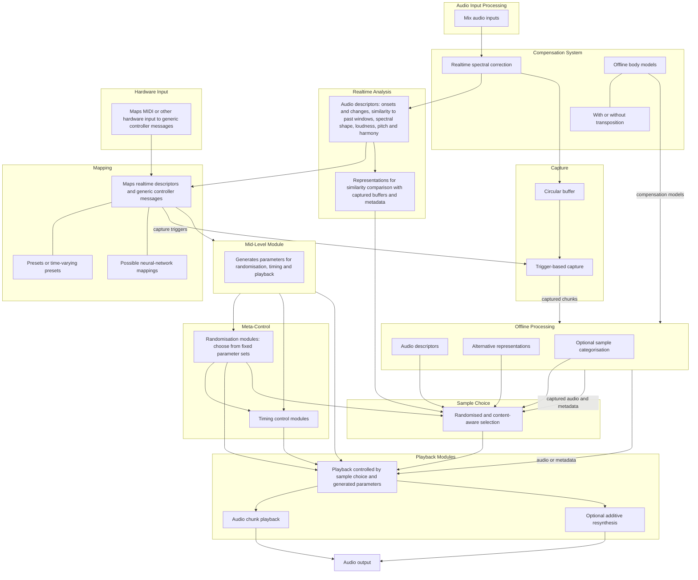
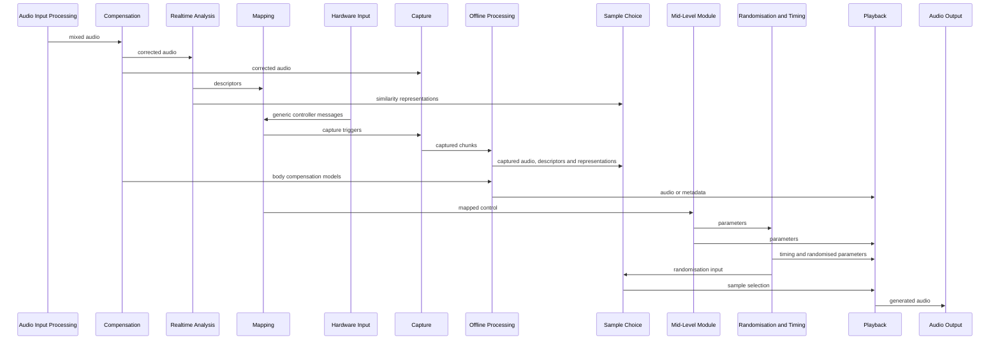

# Marco Fusi Piece - System Architecture

This document describes the proposed system modules and their data flow based on [Basic Systems Ideas](./Basic%20Systems%20Ideas.md). The score-activity model and the placement of timing and randomisation remain open design questions.

## Architecture

## Module Responsibilities

### Audio input and compensation

The audio input processing module mixes inputs, applies realtime spectral correction, and sends the corrected signal to both capture and realtime analysis. The compensation system also includes offline body models that support compensation from one body to another, with or without transposition.

### Realtime analysis

Realtime analysis produces descriptors for the mapping module:

- Onsets and other changes
- Similarity to past windows
- Spectral shape
- Loudness
- Pitch and harmony

It also produces representations used to compare live material with captured buffers and their metadata for sample choice.

### Capture and offline processing

Capture uses a circular buffer and receives capture triggers from the mapping module. Captured chunks go to offline processing, which derives descriptors and alternative representations, and may categorise samples. This processed audio and metadata are available to sample choice and playback.

### Mapping, control, and sample choice

The hardware input module abstracts MIDI and other hardware input into generic controller messages for mapping. Mapping combines these messages with realtime analysis and may use presets, time-varying presets, or neural-network-based mappings. It triggers capture and controls the mid-level module.

The mid-level module generates parameters for randomisation, timing, and playback. Randomisation modules select parameters from a fixed set and can control timing or playback. Timing modules control playback. Sample choice combines randomisation with content-aware selection using captured audio, its offline metadata, and realtime similarity representations.

### Playback

Playback modules are driven by sample choice and control parameters. They can play audio chunks or use metadata/representations from offline processing; additive resynthesis is one possible playback type. Playback modules produce the audio output.

## Dataflow

## Open Design Questions

- How should the system model the basic types of activity in the score?
- Where should randomisation and timing be embedded, and how should they depend on context?
