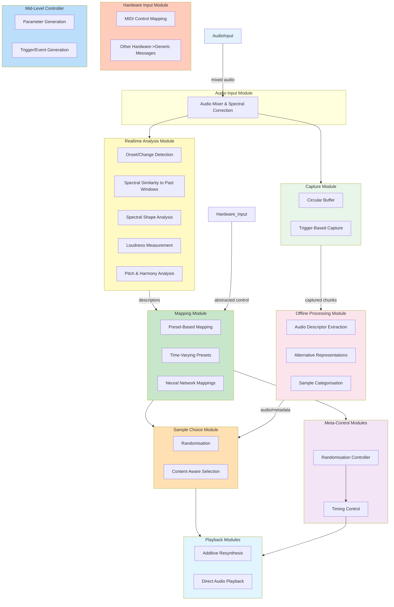
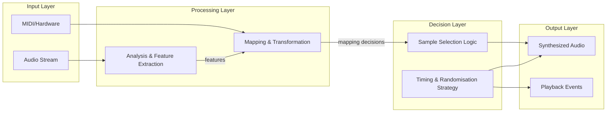
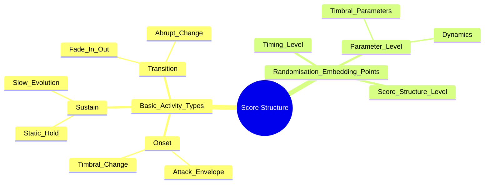
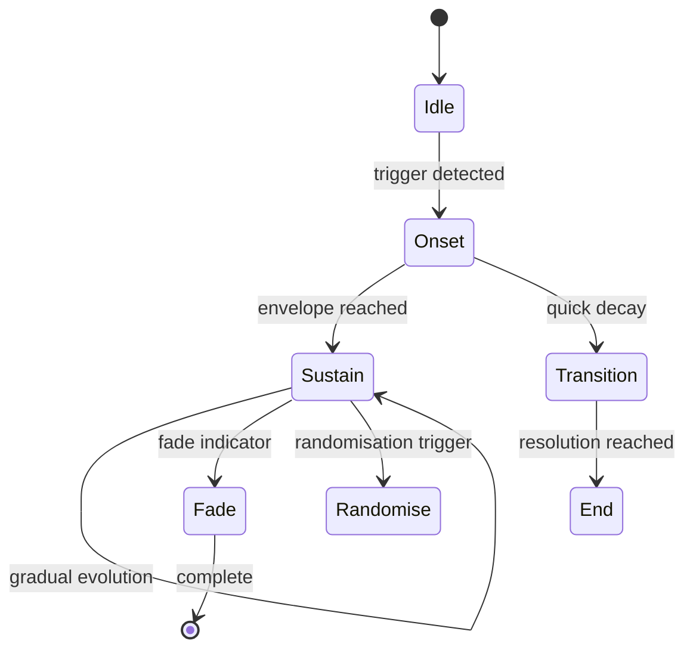

# Marco Fusi Piece - System Architecture Visualization

## Main Architecture Diagram

## Dataflow Representation

## Score Activity Model

## State Machine for Activity Modeling

## Module Interaction Details

## Key Design Principles Summary

1. **Dual Analysis Path**: Realtime vs Offline processing
2. **Buffer-Based Capture**: Circular buffer for trigger capture
3. **Multi-Modal Input**: Audio + MIDI/Hardware + spectral features
4. **Flexible Mapping**: Presets, time-varying, or neural mappings
5. **Content-Aware Randomisation**: Contextualised decision making

---

### Alternative Representations Available:

1. **JSON Schema** - For programmatic representation
2. **UML Class Diagram** - If implementing as a class-based architecture
3. **Gantt Timeline** - For execution timing visualization
4. **Network Graph** - Node-link diagram for system connections
5. **HTML Interactive Diagram** - Clickable web visualization

Would you like me to generate any of these additional visual formats?