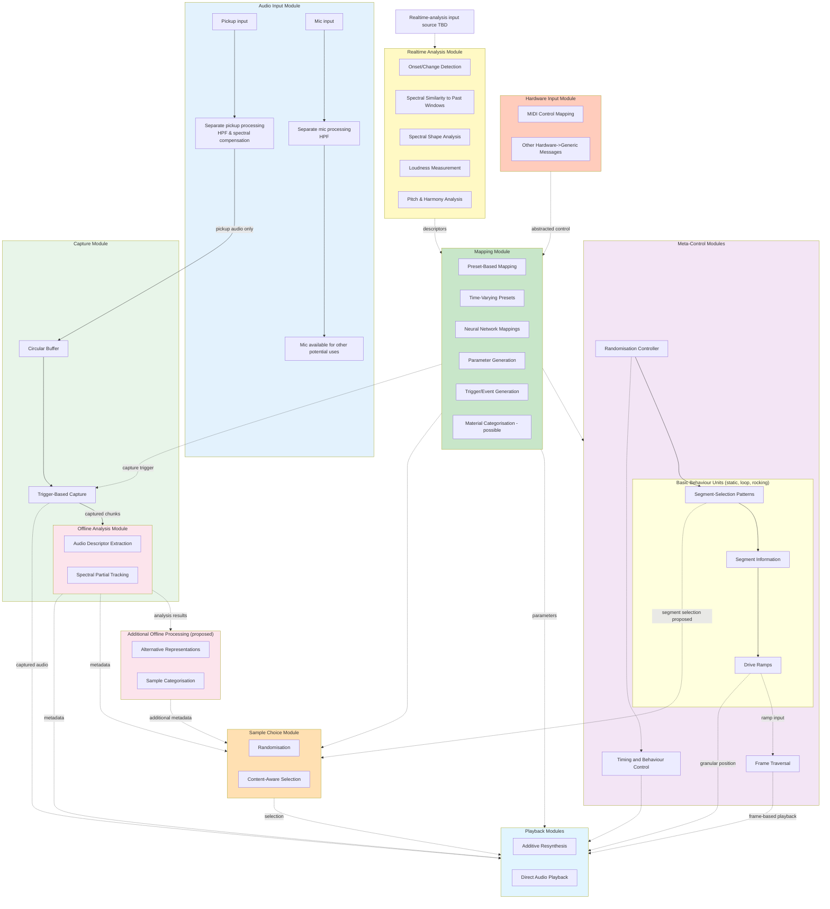
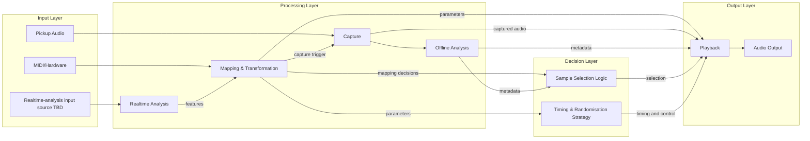
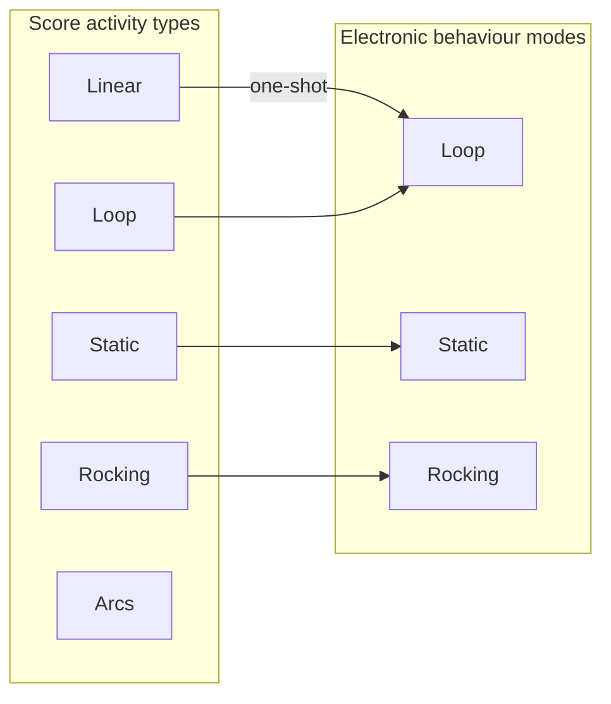
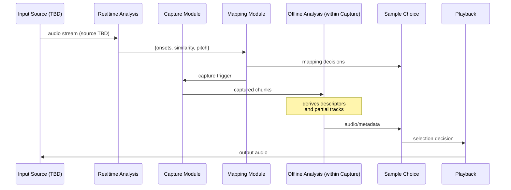

# **Marco Fusi Piece - System Architecture Visualization**

## **Main Architecture Diagram**

Dashed links represent proposed or not-yet-identified integrations.

## **Dataflow Representation**

This is a conceptual dataflow; connections to mapping, sample choice, and playback are not yet identified as integrated.

## **Score Activity Model**

The [timing module notes](./Timing%20Module%20Modes.md) relate score activity types to the electronics' behaviour modes. Arcs have no direct electronic equivalent identified there.

## **Module Interaction Details**

## **Current Implementation Status**

The statuses below are additions to the proposed architecture above, not changes to it. They are based on the current Max patches, [patch progress notes](./wintersleep-patch/docs/Patch%20Progress%20%2B%20Notes.md); they reflect patch inspection, not runtime testing. **Not found** means no implementation was identified in those sources. Areas with outstanding review items are marked **Review**, a status below **Implemented** and above **Partial**; a review item does not necessarily mean functionality is absent. Outstanding implementation work is listed separately as TODO, while stretch enhancements are in the final column.

| Area                          | Status          | Evidence                                                                                                                                                                                                                                                                                                                                                                                                                                                                                                                                                                                                                                                                                                                                                                                                                                                                                                                                                                                                                                                                                                                                                                                                                                                                                                                                                                                                                                                                                                                                                                                                                                                                                                                                                                        | Review                                                                                                                                                              | TODO                                                                                             | Stretch Features                        |
| ----------------------------- | --------------- | ------------------------------------------------------------------------------------------------------------------------------------------------------------------------------------------------------------------------------------------------------------------------------------------------------------------------------------------------------------------------------------------------------------------------------------------------------------------------------------------------------------------------------------------------------------------------------------------------------------------------------------------------------------------------------------------------------------------------------------------------------------------------------------------------------------------------------------------------------------------------------------------------------------------------------------------------------------------------------------------------------------------------------------------------------------------------------------------------------------------------------------------------------------------------------------------------------------------------------------------------------------------------------------------------------------------------------------------------------------------------------------------------------------------------------------------------------------------------------------------------------------------------------------------------------------------------------------------------------------------------------------------------------------------------------------------------------------------------------------------------------------------------------- | ------------------------------------------------------------------------------------------------------------------------------------------------------------------- | ------------------------------------------------------------------------------------------------ | --------------------------------------- |
| **Descriptor-frame analysis** | **Implemented** | [Analysis_Descriptor_Frame.maxpat](./wintersleep-patch/Analysis_Descriptor_Frame.maxpat) provides descriptor analysis; [Analysis_NRT_ToFrames.maxpat](./wintersleep-patch/Analysis_NRT_ToFrames.maxpat) extracts frames from buffered audio. [Analysis_NRT_Stats.maxpat](./wintersleep-patch/Analysis_NRT_Stats.maxpat) computes per-descriptor statistics; [Utility_Gate_Other.maxpat](./wintersleep-patch/Utility_Gate_Other.maxpat) provides descriptor gating. NRT secondary-analysis decisions are made.                                                                                                                                                                                                                                                                                                                                                                                                                                                                                                                                                                                                                                                                                                                                                                                                                                                                                                                                                                                                                                                                                                                                                                                                                                                                   | —                                                                                                                                                                   | —                                                                                                | —                                       |
| **Offline sample processing** | **Implemented** | [Module_Offline_Analysis.maxpat](./wintersleep-patch/Module_Offline_Analysis.maxpat) manages threading, segment-number validation and storage, using [Data_Segments.maxpat](./wintersleep-patch/Data_Segments.maxpat) to access segment data, and invokes [Analysis_NRT_Analysis.maxpat](./wintersleep-patch/Analysis_NRT_Analysis.maxpat), which runs descriptor and partial-tracking analysis. [Analysis_NRT_Descriptor_Analysis.maxpat](./wintersleep-patch/Analysis_NRT_Descriptor_Analysis.maxpat) uses [Analysis_NRT_ToFrames.maxpat](./wintersleep-patch/Analysis_NRT_ToFrames.maxpat), [Analysis_Descriptor_Frame.maxpat](./wintersleep-patch/Analysis_Descriptor_Frame.maxpat), per-descriptor [Analysis_NRT_Stats.maxpat](./wintersleep-patch/Analysis_NRT_Stats.maxpat), and [Utility_Gate_Other.maxpat](./wintersleep-patch/Utility_Gate_Other.maxpat) for gating. A broader alternative-representation or categorisation pipeline is not identified.                                                                                                                                                                                                                                                                                                                                                                                                                                                                                                                                                                                                                                                                                                                                                                                                               | —                                                                                                                                                                   | —                                                                                                | —                                       |
| **Randomisation**             | **Implemented** | Randomisation utility patches are present.                                                                                                                                                                                                                                                                                                                                                                                                                                                                                                                                                                                                                                                                                                                                                                                                                                                                                                                                                                                                                                                                                                                                                                                                                                                                                                                                                                                                                                                                                                                                                                                                                                                                                                                                      | —                                                                                                                                                                   | —                                                                                                | —                                       |
| **Spectral partial tracking** | **Implemented** | [Analysis_Peaks.maxpat](./wintersleep-patch/Analysis_Peaks.maxpat) derives spectral peaks; [Analysis_Track_Segment.maxpat](./wintersleep-patch/Analysis_Track_Segment.maxpat) turns peaks into tracks for a segment using frame-driving code.                                                                                                                                                                                                                                                                                                                                                                                                                                                                                                                                                                                                                                                                                                                                                                                                                                                                                                                                                                                                                                                                                                                                                                                                                                                                                                                                                                                                                                                                                                                                   | —                                                                                                                                                                   | —                                                                                                | —                                       |
| **Timing and behaviour**      | **Implemented** | Timing and behaviour control is intended to model basic score activities and control playback. [Pattern_Static.maxpat](./wintersleep-patch/Pattern_Static.maxpat), [Pattern_Loop.maxpat](./wintersleep-patch/Pattern_Loop.maxpat), and [Pattern_Rocking.maxpat](./wintersleep-patch/Pattern_Rocking.maxpat) use randomisation to control segment selection and map to behaviour types in the score. [Behaviour_Static.maxpat](./wintersleep-patch/Behaviour_Static.maxpat), [Behaviour_Loop.maxpat](./wintersleep-patch/Behaviour_Loop.maxpat), and [Behaviour_Rocking.maxpat](./wintersleep-patch/Behaviour_Rocking.maxpat) combine patterns with [segment information](./wintersleep-patch/Drive_Segment_Info.maxpat) and [timing ramps](./wintersleep-patch/Drive_Ramps.maxpat) to drive playback. Loop and rocking use [Behaviour_Segment_Ramps.maxpat](./wintersleep-patch/Behaviour_Segment_Ramps.maxpat) and support speed, direction, linking to additive parameters, waiting for random segments, and stopping; loop also supports mutations and a linear one-shot mode. Static uses [Behaviour_Static_Ramps.maxpat](./wintersleep-patch/Behaviour_Static_Ramps.maxpat) and supports speed, linking to additive parameters, and stopping. The ramps can drive granular position; [Drive_Frame_Traversal.maxpat](./wintersleep-patch/Drive_Frame_Traversal.maxpat) supports ramp-driven frame playback. [Drive_Timed_Partials.maxpat](./wintersleep-patch/Drive_Timed_Partials.maxpat) combines control mechanisms for partial playback. [Behaviour_Retrigger.maxpat](./wintersleep-patch/Behaviour_Retrigger.maxpat) provides a retrigger behaviour, and [Behaviours.maxpat](./wintersleep-patch/Behaviours.maxpat) provides a unified interface with state reporting. | —                                                                                                                                                                   | —                                                                                                | —                                       |
| **Audio input**               | **Review**      | Mic and pickup are processed separately; both have an 80 Hz/order 8 high-pass filter. Pickup compensation and circular input buffering are present in [Module_Input.maxpat](./wintersleep-patch/Module_Input.maxpat). Only pickup feeds capture; the mic remains available for other potential uses.                                                                                                                                                                                                                                                                                                                                                                                                                                                                                                                                                                                                                                                                                                                                                                                                                                                                                                                                                                                                                                                                                                                                                                                                                                                                                                                                                                                                                                                                            | Define mechanisms for setting parameters for the piece; decide the realtime-analysis input source.                                                                  | —                                                                                                | —                                       |
| **Capture**                   | **Review**      | [Module_Capture.maxpat](./wintersleep-patch/Module_Capture.maxpat) contains and directly drives [Module_Offline_Analysis.maxpat](./wintersleep-patch/Module_Offline_Analysis.maxpat). Circular buffering and buffer copying/collection exist in [Capture_Circular_Buffer.maxpat](./wintersleep-patch/Capture_Circular_Buffer.maxpat) and [Capture_Buffers.maxpat](./wintersleep-patch/Capture_Buffers.maxpat). The buffer defaults to three minutes with no direct duration control; NRT analysis is also available separately. Capture is currently instant; a delay control is routed to [Capture_Timings.maxpat](./wintersleep-patch/Capture_Timings.maxpat), but delay handling is not yet implemented there.                                                                                                                                                                                                                                                                                                                                                                                                                                                                                                                                                                                                                                                                                                                                                                                                                                                                                                                                                                                                                                                               | Consider a fixed capture delay for alignment with analysis.                                                                                                         | Fix the sample-rate-related capture-timing bug.                                                  | —                                       |
| **Compensation**              | **Review**      | Offline rolloff, body-IR, and transposition patches exist: [Compensate_Rolloff.maxpat](./wintersleep-patch/Compensate_Rolloff.maxpat), [Compensate_BodyIR.maxpat](./wintersleep-patch/Compensate_BodyIR.maxpat), and [Compensate_Transpose.maxpat](./wintersleep-patch/Compensate_Transpose.maxpat). Realtime compensation is implemented in [Compensate_Realtime.maxpat](./wintersleep-patch/Compensate_Realtime.maxpat), with [- Pickup_Correction.maxpat](./wintersleep-patch/-%20Pickup_Correction.maxpat) as its preparation patch and including a regularisation control. Bounds handling is in the call patch and mapped to 44.1 kHz.                                                                                                                                                                                                                                                                                                                                                                                                                                                                                                                                                                                                                                                                                                                                                                                                                                                                                                                                                                                                                                                                                                                                    | Review smoothing behavior/defaults and whether to expose settings; whether bounds handling belongs in the IR patch; whether rolloff should clip below MIDI note 46. | —                                                                                                | —                                       |
| **Hardware input**            | **Review**      | Launch Control faders, encoders, and buttons exist in [Controller_LaunchControl.maxpat](./wintersleep-patch/Controller_LaunchControl.maxpat). MIDI input targets the Launch Control device. Labels and static colors can be assigned in the editor.                                                                                                                                                                                                                                                                                                                                                                                                                                                                                                                                                                                                                                                                                                                                                                                                                                                                                                                                                                                                                                                                                                                                                                                                                                                                                                                                                                                                                                                                                                                             | Review labeling and colors.                                                                                                                                         | —                                                                                                | Extra buttons, screen display and LEDs. |
| **Playback**                  | **Review**      | [Module_Playback.maxpat](./wintersleep-patch/Module_Playback.maxpat) hosts [Voice_Partial.maxpat](./wintersleep-patch/Voice_Partial.maxpat) and [Voice_Granular.maxpat](./wintersleep-patch/Voice_Granular.maxpat) for additive partial and granular playback. Partial resynthesis uses [DSP_Oscillator.maxpat](./wintersleep-patch/DSP_Oscillator.maxpat); the granular path uses [DSP_Granular.maxpat](./wintersleep-patch/DSP_Granular.maxpat). Both paths pan directly into quad, and voice hosting/management is present.                                                                                                                                                                                                                                                                                                                                                                                                                                                                                                                                                                                                                                                                                                                                                                                                                                                                                                                                                                                                                                                                                                                                                                                                                                                  | Review how granular and partial playback are switched on/off and whether additive voice parameters should be dynamically controllable.                              | —                                                                                                | —                                       |
| **Reverb**                    | **Review**      | [DSP_Reverb.maxpat](./wintersleep-patch/DSP_Reverb.maxpat) now encodes the quad input to horizontal B-format, convolves it with a 3x3 matrix of nine IR buffers using [IR-W-W.wav](./wintersleep-patch/IR-W-W.wav) and its companion IR files, then decodes to quad. [IR_Convert.py](./IR%20Preparation/IR_Convert.py) prepares nine linked-peak-normalized, 48 kHz, six-second, 32-bit-float matrix IRs from the twelve speaker/mic captures.                                                                                                                                                                                                                                                                                                                                                                                                                                                                                                                                                                                                                                                                                                                                                                                                                                                                                                                                                                                                                                                                                                   | Confirm the performance sample rate; review pre-delay chopping and direct-sound removal.                                                                               | —                                                                                                 | —                                       |
| **Realtime analysis**         | **Partial**     | [Analysis_Descriptors_RT.maxpat](./wintersleep-patch/Analysis_Descriptors_RT.maxpat) wraps descriptor-frame analysis for realtime audio. Mapping integration is not identified; see Mapping.                                                                                                                                                                                                                                                                                                                                                                                                                                                                                                                                                                                                                                                                                                                                                                                                                                                                                                                                                                                                                                                                                                                                                                                                                                                                                                                                                                                                                                                                                                                                                                                    | —                                                                                                                                                                   | Add basic onset triggers in a new Module_RT_Analysis patch.                                      | —                                       |
| **Sample choice**             | **Partial**     | Segment-selection patterns exist in timing and behaviour control. An integrated sample-choice module and content-aware selection are not identified.                                                                                                                                                                                                                                                                                                                                                                                                                                                                                                                                                                                                                                                                                                                                                                                                                                                                                                                                                                                                                                                                                                                                                                                                                                                                                                                                                                                                                                                                                                                                                                                                                            | —                                                                                                                                                                   | —                                                                                                | —                                       |
| **Mapping**                   | **Not found**   | [Mapping.md](./Mapping.md) documents candidate mapping inputs and parameter groupings, but no mapping implementation is identified in the available patches. The proposed module would generate parameters for randomisation, timing, and playback, and may categorise materials.                                                                                                                                                                                                                                                                                                                                                                                                                                                                                                                                                                                                                                                                                                                                                                                                                                                                                                                                                                                                                                                                                                                                                                                                                                                                                                                                                                                                                                                                                                                                                                                               | —                                                                                                                                                                   | —                                                                                                | —                                       |
