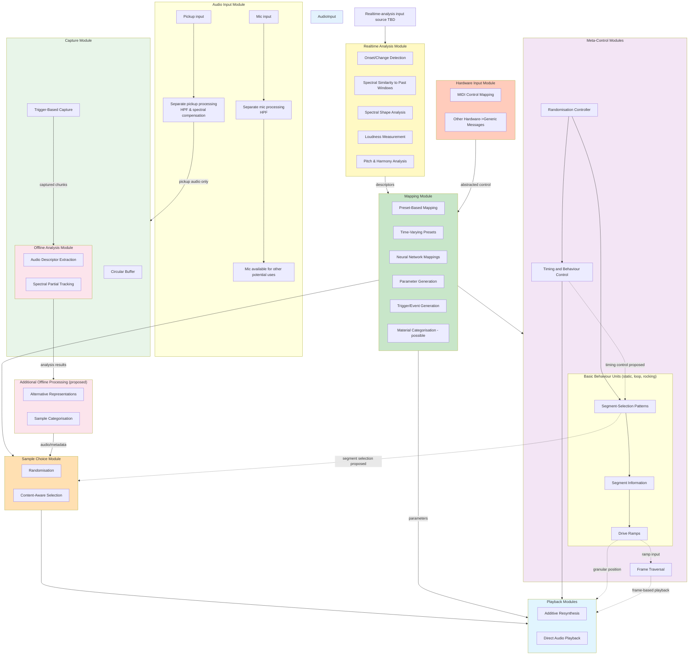
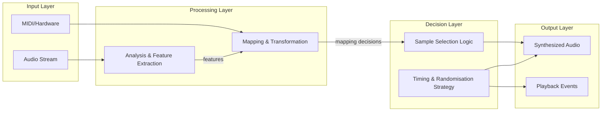
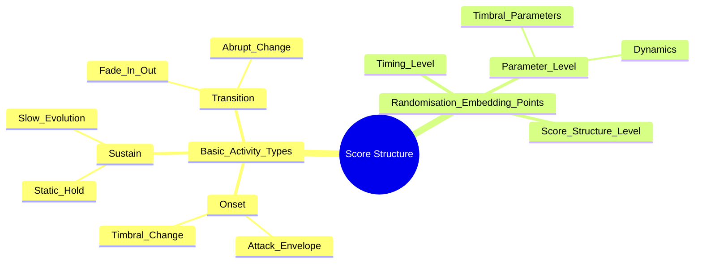
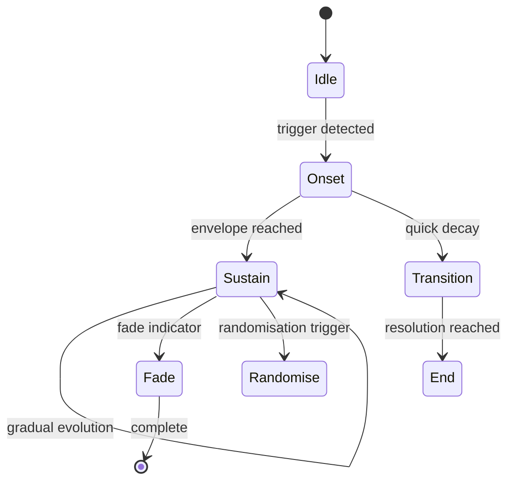
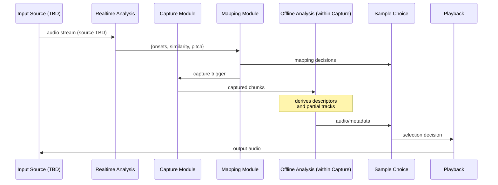

# **Marco Fusi Piece - System Architecture Visualization**

## **Main Architecture Diagram**

## **Dataflow Representation**

## **Score Activity Model**

Conceptual activity types for the timing and behaviour control modules.

## **State Machine for Activity Modeling**

## **Module Interaction Details**

## **Current Implementation Status**

The statuses below are additions to the proposed architecture above, not changes to it. They are based on the current Max patches and [patch progress notes](./wintersleep-patch/docs/Patch%20Progress%20%2B%20Notes.md); they reflect patch inspection, not runtime testing. **Not found** means no implementation was identified in those sources. Items marked for review are follow-up questions and do not by themselves indicate missing implementation; outstanding implementation work is identified separately as TODO.

| Area | Status | Evidence | Review | TODO |
|---|---|---|---|---|
| **Audio input** | **Implemented** | Mic and pickup are processed separately; both have an 80 Hz/order 8 high-pass filter. Pickup compensation and circular input buffering are present in [Module_Input.maxpat](./wintersleep-patch/Module_Input.maxpat). Only pickup feeds capture; the mic remains available for other potential uses. | Define mechanisms for setting parameters for the piece; decide the realtime-analysis input source. | — |
| **Compensation** | **Implemented** | Offline rolloff, body-IR, and transposition patches exist: [Compensate_Rolloff.maxpat](./wintersleep-patch/Compensate_Rolloff.maxpat), [Compensate_BodyIR.maxpat](./wintersleep-patch/Compensate_BodyIR.maxpat), and [Compensate_Transpose.maxpat](./wintersleep-patch/Compensate_Transpose.maxpat). Realtime compensation is implemented in [Compensate_Realtime.maxpat](./wintersleep-patch/Compensate_Realtime.maxpat), with [- Pickup_Correction.maxpat](./wintersleep-patch/-%20Pickup_Correction.maxpat) as its preparation patch and including a regularisation control. Bounds handling is in the call patch and mapped to 44.1 kHz. | Review smoothing behavior/defaults and whether to expose settings; whether bounds handling belongs in the IR patch; whether rolloff should clip below MIDI note 46. | — |
| **Capture** | **Implemented** | [Module_Capture.maxpat](./wintersleep-patch/Module_Capture.maxpat) contains and directly drives [Module_Offline_Analysis.maxpat](./wintersleep-patch/Module_Offline_Analysis.maxpat). Circular buffering and buffer copying/collection exist in [Capture_Circular_Buffer.maxpat](./wintersleep-patch/Capture_Circular_Buffer.maxpat) and [Capture_Buffers.maxpat](./wintersleep-patch/Capture_Buffers.maxpat). The buffer defaults to three minutes with no direct duration control; NRT analysis is also available separately. Capture is currently instant; a delay control is routed to [Capture_Timings.maxpat](./wintersleep-patch/Capture_Timings.maxpat), but delay handling is not yet implemented there. | Consider a fixed capture delay for alignment with analysis. | — |
| **Hardware input** | **Implemented** | Launch Control faders, encoders, and buttons exist in [Controller_LaunchControl.maxpat](./wintersleep-patch/Controller_LaunchControl.maxpat). Labels and static colors can be assigned in the editor. | Review all-MIDI-input versus targeted-port behavior, additional controls/display/LEDs, message normalization, and labeling. | — |
| **Descriptor-frame analysis** | **Implemented** | [Analysis_Descriptor_Frame.maxpat](./wintersleep-patch/Analysis_Descriptor_Frame.maxpat) provides descriptor analysis; [Analysis_NRT_ToFrames.maxpat](./wintersleep-patch/Analysis_NRT_ToFrames.maxpat) extracts frames from buffered audio. [Analysis_NRT_Stats.maxpat](./wintersleep-patch/Analysis_NRT_Stats.maxpat) computes per-descriptor statistics; [Utility_Gate_Other.maxpat](./wintersleep-patch/Utility_Gate_Other.maxpat) provides descriptor gating. NRT secondary-analysis decisions are made. | — | — |
| **Offline sample processing** | **Implemented** | [Module_Offline_Analysis.maxpat](./wintersleep-patch/Module_Offline_Analysis.maxpat) manages threading and storage and invokes [Analysis_NRT_Analysis.maxpat](./wintersleep-patch/Analysis_NRT_Analysis.maxpat), which runs descriptor and partial-tracking analysis. [Analysis_NRT_Descriptor_Analysis.maxpat](./wintersleep-patch/Analysis_NRT_Descriptor_Analysis.maxpat) uses [Analysis_NRT_ToFrames.maxpat](./wintersleep-patch/Analysis_NRT_ToFrames.maxpat), [Analysis_Descriptor_Frame.maxpat](./wintersleep-patch/Analysis_Descriptor_Frame.maxpat), per-descriptor [Analysis_NRT_Stats.maxpat](./wintersleep-patch/Analysis_NRT_Stats.maxpat), and [Utility_Gate_Other.maxpat](./wintersleep-patch/Utility_Gate_Other.maxpat) for gating. A broader alternative-representation or categorisation pipeline is not identified. | Review storage. | — |
| **Spectral partial tracking** | **Implemented** | [Analysis_Peaks.maxpat](./wintersleep-patch/Analysis_Peaks.maxpat) derives spectral peaks; [Analysis_Track_Segment.maxpat](./wintersleep-patch/Analysis_Track_Segment.maxpat) turns peaks into tracks for a segment using frame-driving code. | — | — |
| **Randomisation** | **Implemented** | Randomisation utility patches are present. | — | — |
| **Realtime analysis** | **Partial** | [Analysis_Descriptors_RT.maxpat](./wintersleep-patch/Analysis_Descriptors_RT.maxpat) wraps descriptor-frame analysis for realtime audio. Mapping integration is not identified; see Mapping. | — | Decide on secondary realtime analysis; this affects realtime analysis, not frame-based analysis. |
| **Playback** | **Partial** | [Voice_Partial.maxpat](./wintersleep-patch/Voice_Partial.maxpat) provides additive resynthesis using [DSP_Oscillator.maxpat](./wintersleep-patch/DSP_Oscillator.maxpat) and related DSP components; the patch notes say it avoids aliasing internally. The voice uses dynamic.this~ and dynamic.out~; filtering times and partial delays are in milliseconds. [DSP_Granular.maxpat](./wintersleep-patch/DSP_Granular.maxpat) provides a basic framelib granular patch; wider voice management is not yet in place. | Review panning: additive has none yet; granular is stereo and could be panned at voice level to quad or made inherently quad per voice. Consider whether additive voice parameters need dynamic control and whether removing sig~ objects could save resources; review integration with control modules. | Build voice management and address voice-level concerns. |
| **Sample choice** | **Partial** | Segment-selection patterns exist in timing and behaviour control. An integrated sample-choice module and content-aware selection are not identified. | — | — |
| **Timing and behaviour** | **Partial** | Timing and behaviour control is intended to model basic score activities and control playback. [Pattern_Static.maxpat](./wintersleep-patch/Pattern_Static.maxpat), [Pattern_Loop.maxpat](./wintersleep-patch/Pattern_Loop.maxpat), and [Pattern_Rocking.maxpat](./wintersleep-patch/Pattern_Rocking.maxpat) use randomisation to control segment selection and map to behaviour types in the score. [Behaviour_Static.maxpat](./wintersleep-patch/Behaviour_Static.maxpat), [Behaviour_Loop.maxpat](./wintersleep-patch/Behaviour_Loop.maxpat), and [Behaviour_Rocking.maxpat](./wintersleep-patch/Behaviour_Rocking.maxpat) combine patterns with [segment information](./wintersleep-patch/Drive_Segment_Info.maxpat) and [timing ramps](./wintersleep-patch/Drive_Ramps.maxpat) to drive playback. Loop and rocking use [Behaviour_Segment_Ramps.maxpat](./wintersleep-patch/Behaviour_Segment_Ramps.maxpat) and support speed, direction, linking to additive parameters, and stopping; loop also supports a linear one-shot mode. The ramps can drive granular position; [Drive_Frame_Traversal.maxpat](./wintersleep-patch/Drive_Frame_Traversal.maxpat) supports ramp-driven frame playback. | Review algorithm descriptions. | Add mutations and waits to loop; finish static behaviour. |
| **Mapping** | **Not found** | No implementation is identified in the available patches. The proposed mapping module generates parameters for randomisation, timing, and playback, and may categorise materials. | — | — |
