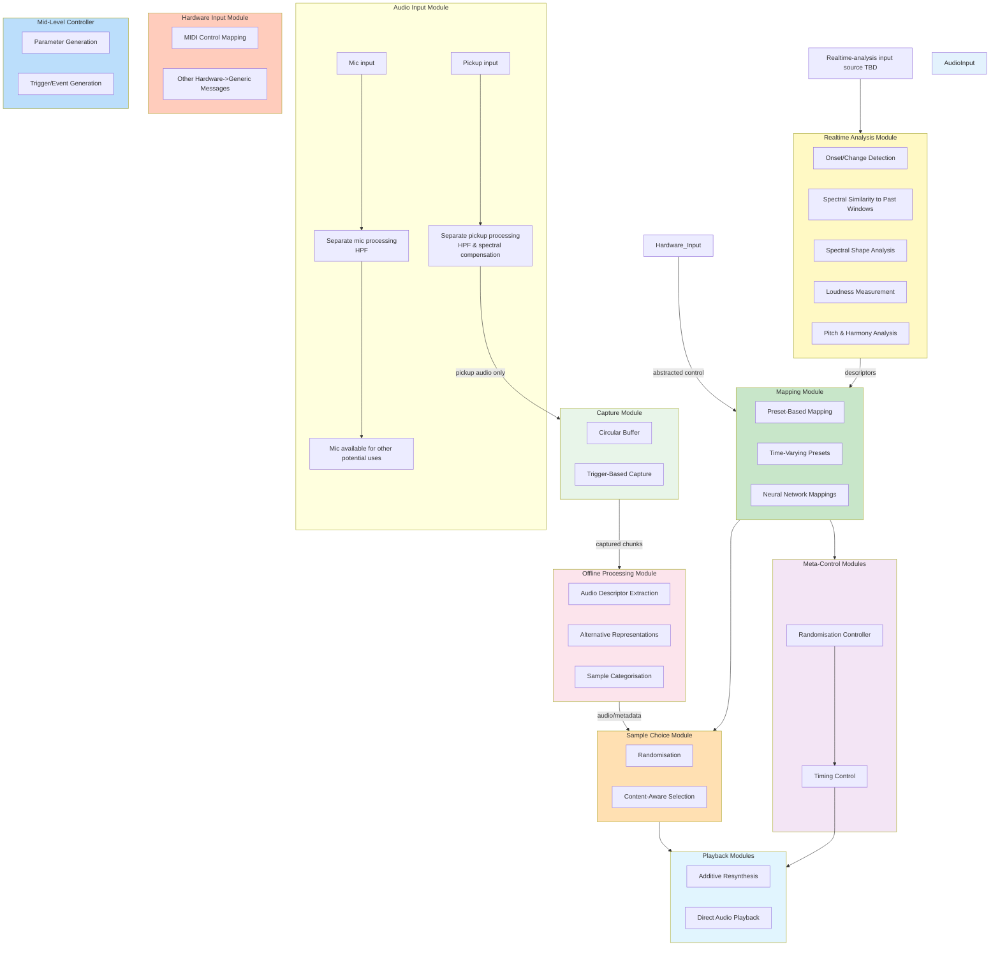
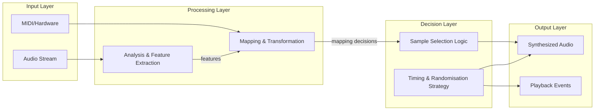
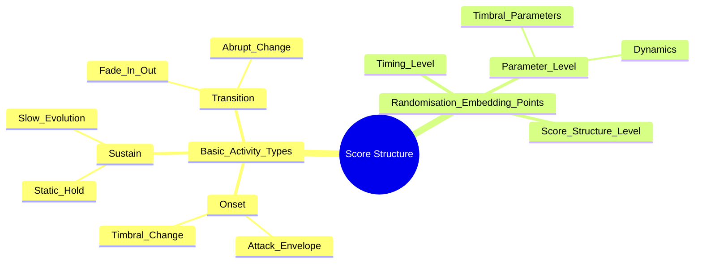
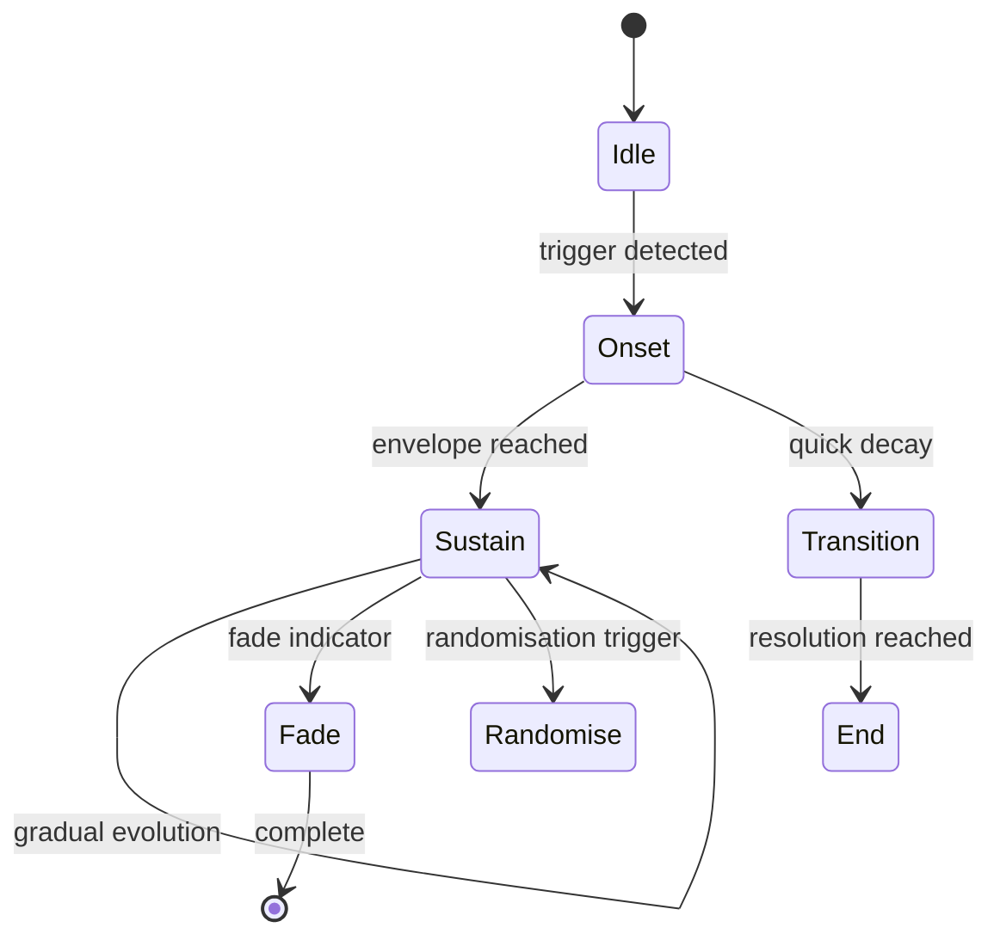
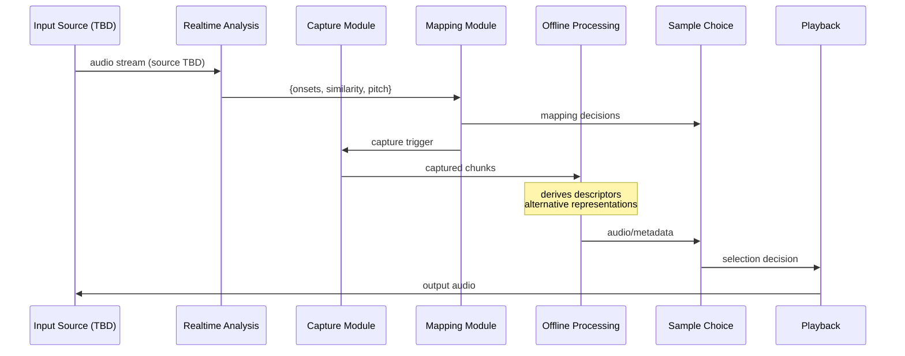

# **Marco Fusi Piece - System Architecture Visualization**

## **Main Architecture Diagram**

## **Dataflow Representation**

## **Score Activity Model**

## **State Machine for Activity Modeling**

## **Module Interaction Details**

## **Key Design Principles Summary**

1. **Dual Analysis Path**: Realtime vs Offline processing
2. **Buffer-Based Capture**: Circular buffer for trigger capture
3. **Multi-Modal Input**: Audio + MIDI/Hardware + spectral features
4. **Flexible Mapping**: Presets, time-varying, or neural mappings
5. **Content-Aware Randomisation**: Contextualised decision making

---

### **Alternative Representations Available:**

1. **JSON Schema** - For programmatic representation
2. **UML Class Diagram** - If implementing as a class-based architecture
3. **Gantt Timeline** - For execution timing visualization
4. **Network Graph** - Node-link diagram for system connections
5. **HTML Interactive Diagram** - Clickable web visualization

Would you like me to generate any of these additional visual formats?

## **Current Implementation Status**

The statuses below are additions to the proposed architecture above, not changes to it. They are based on the current Max patches and [patch progress notes](./wintersleep-patch/docs/Patch%20Progress%20%2B%20Notes.md); they reflect patch inspection, not runtime testing. **Not found** means no implementation was identified in those sources.

| Area | Status | Current evidence / outstanding work |
|---|---|---|
| **Audio input** | **Implemented** | Mic and pickup are processed separately; both have an 80 Hz/order 8 high-pass filter, and pickup compensation and a circular input buffer are present in [Module_Input.maxpat](./wintersleep-patch/Module_Input.maxpat). Only pickup feeds capture; the mic remains available for other potential uses. Parameter-setting mechanisms for the piece remain to be reviewed. Realtime-analysis routing is a separate system-level question. |
| **Compensation** | **Implemented** | Offline rolloff, body-IR, and transposition patches exist. Realtime compensation is implemented in [Compensate_Realtime.maxpat](./wintersleep-patch/Compensate_Realtime.maxpat), with [- Pickup_Correction.maxpat](./wintersleep-patch/-%20Pickup_Correction.maxpat) serving as its preparation patch and including a regularisation control. Review smoothing behavior/defaults and whether to expose its settings; bounds handling is in the call patch and mapped to 44.1 kHz. Also review whether bounds handling belongs in the IR patch, bounds handling in additive processing, and rolloff below MIDI note 46. |
| **Capture** | **Partial** | Circular buffering and buffer copying/collection exist in [Capture_Circular_Buffer.maxpat](./wintersleep-patch/Capture_Circular_Buffer.maxpat) and [Capture_Buffers.maxpat](./wintersleep-patch/Capture_Buffers.maxpat). The buffer defaults to three minutes with no direct duration control. NRT buffer analysis is available separately; wiring the capture-to-analysis workflow and deciding whether to bundle realtime analysis with buffers remain open. |
| **Hardware input** | **Implemented** | Launch Control faders, encoders, and buttons exist in [Controller_LaunchControl.maxpat](./wintersleep-patch/Controller_LaunchControl.maxpat). Review all-MIDI-input versus targeted-port behavior, extra controls/display/LEDs, and message normalization; labels and static colors can be assigned in the editor. |
| **Descriptor-frame analysis** | **Partial** | [Analysis_Descriptor_Frame.maxpat](./wintersleep-patch/Analysis_Descriptor_Frame.maxpat) provides descriptor analysis; [Analysis_NRT_ToFrames.maxpat](./wintersleep-patch/Analysis_NRT_ToFrames.maxpat) extracts frames from buffered audio. [Analysis_NRT_Stats.maxpat](./wintersleep-patch/Analysis_NRT_Stats.maxpat) computes per-descriptor statistics, and [Utility_Gate_Other.maxpat](./wintersleep-patch/Utility_Gate_Other.maxpat) provides descriptor gating. Offline secondary-analysis decisions are made; NRT frame-range handling, including buffer edges and non-useful frames, is being revised/needs validation. Partial analysis exists separately but still needs integration with the descriptor and buffer-analysis workflow. |
| **Realtime analysis** | **Partial** | [Analysis_Descriptors_RT.maxpat](./wintersleep-patch/Analysis_Descriptors_RT.maxpat) wraps descriptor-frame analysis for realtime audio. Realtime secondary-analysis decisions and integration with capture/mapping remain unfinished. |
| **Offline sample processing** | **Partial** | [Analysis_NRT_Buffer_Analysis.maxpat](./wintersleep-patch/Analysis_NRT_Buffer_Analysis.maxpat) implements a buffered-audio analysis workflow using frame extraction, descriptor analysis, per-descriptor statistics, and gating. NRT frame-range handling, including buffer edges and non-useful frames, is being revised/needs validation. A broader pipeline for alternative representations or categorisation is not identified. |
| **Spectral partial tracking** | **Partial** | [Analysis_Peaks.maxpat](./wintersleep-patch/Analysis_Peaks.maxpat) derives spectral peaks, and [Analysis_Track_Segment.maxpat](./wintersleep-patch/Analysis_Track_Segment.maxpat) turns peaks into tracks for a segment using frame-driving code. Integration with the NRT buffer-analysis workflow remains to be confirmed; descriptor and peak frame driving are separate and may duplicate some processing. |
| **Sample choice** | **Not found** | Content-aware or sample-based selection is not identified. |
| **Playback** | **Not found** | Captured-sample playback and additive resynthesis are not identified. |
| **Synthesis** | **Partial** | [DSP_Oscillator.maxpat](./wintersleep-patch/DSP_Oscillator.maxpat) provides an oscillator with FM, Chebyshev harmonic shaping, and noise/resonance control. Integration with the playback and control modules is not identified. |
| **Randomisation** | **Partial** | Randomisation utility patches are present; building further modules and combinations remains a TODO. Review the reported duplicate-group behavior in Random_Groups, currently used in drift shadow. |
| **Timing control** | **Not found** | No implementation is identified in the available patches. |
| **Mapping** | **Not found** | No implementation is identified in the available patches. |
| **Mid-level control** | **Not found** | No implementation is identified in the available patches. |
| **Score activity model** | **Open** | Modeling the basic score activities and deciding where timing/randomisation should be contextual remain problems to solve. |
