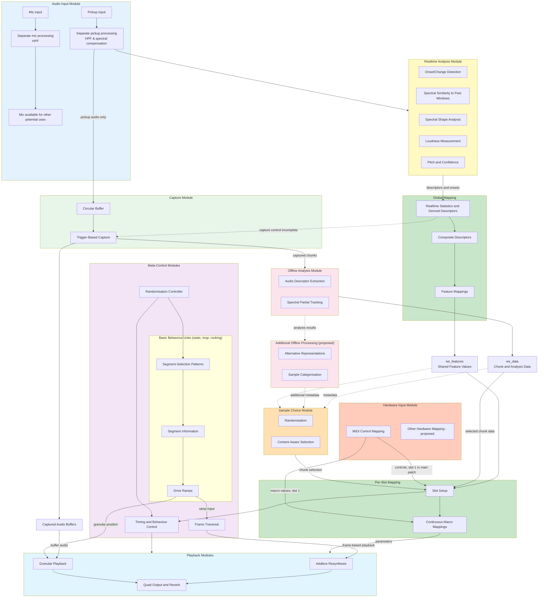
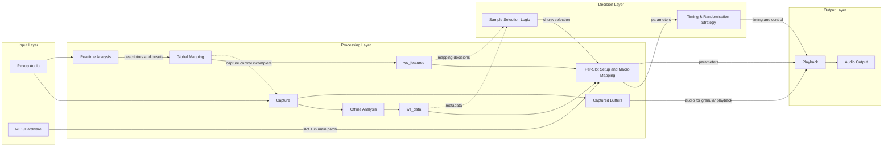
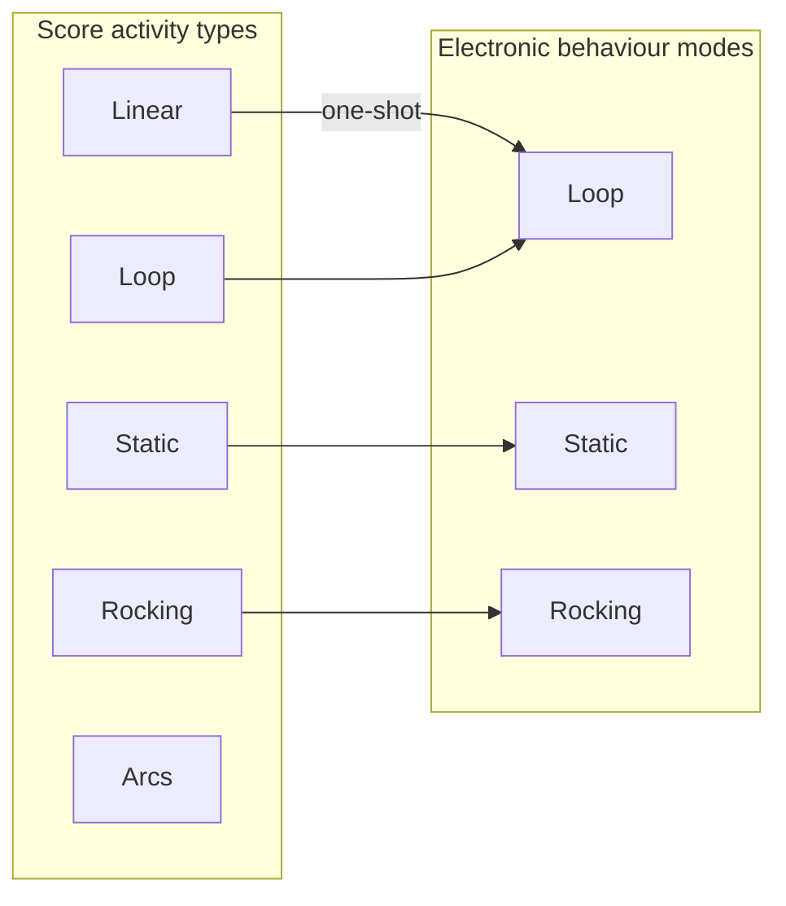
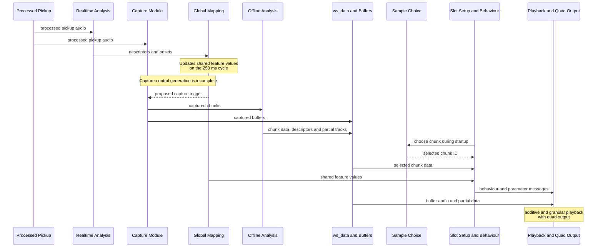

# **Marco Fusi Piece - System Architecture Visualization**

## **Main Architecture Diagram**

Solid links show implemented paths; dashed links show proposed or incomplete integrations. Shared dictionaries and buffers connect modules without direct patch cords.
A sample-choice patch is called during slot startup. Setup code for behaviour-start parameters remains to be added.

## **Dataflow Representation**

This is a simplified dataflow. Dashed links denote incomplete or proposed paths. Sample choice is called during slot startup; generating behaviour-start parameters remains open.

## **Score Activity Model**

The [timing module notes](./Timing%20Module%20Modes.md) relate score activity types to the electronics' behaviour modes. Arcs have no direct electronic equivalent identified there.

## **Module Interaction Details**

## **Current Implementation Status**

The statuses below are based on inspection of the current Max patches, [patch progress notes](./wintersleep-patch/docs/Patch%20Progress%20%2B%20Notes.md), and linked design documents; they reflect patch inspection, not runtime testing. **Not found** means no implementation was identified in those sources. Areas with outstanding review items are marked **Review**, a status below **Implemented** and above **Partial**; a review item does not necessarily mean functionality is absent. Outstanding implementation work is listed separately as TODO, while stretch enhancements are in the final column.

In [Mapping_Sample_Choice.maxpat](./wintersleep-patch/Mapping_Sample_Choice.maxpat), [ws_descriptor_set.txt](./wintersleep-patch/ws_descriptor_set.txt) uses each `_mean` symbol as the `coll` index and its corresponding descriptor symbol as the data value.

| Area                                              | Status          | Evidence                                                                                                                                                                                                                                                                                                                                                                                                                                                                                                                                                                                                                                                                                                                                                                                                                                                                                                                                                                                                                                                                                                                                                                                                                                                                                                                                                                                                                                                                                                                                                                                                                                                                                                                                                                        | Review                                                                                                                                      | TODO                                                                                                                                                      | Stretch Features                                                           |
| ------------------------------------------------- | --------------- | ------------------------------------------------------------------------------------------------------------------------------------------------------------------------------------------------------------------------------------------------------------------------------------------------------------------------------------------------------------------------------------------------------------------------------------------------------------------------------------------------------------------------------------------------------------------------------------------------------------------------------------------------------------------------------------------------------------------------------------------------------------------------------------------------------------------------------------------------------------------------------------------------------------------------------------------------------------------------------------------------------------------------------------------------------------------------------------------------------------------------------------------------------------------------------------------------------------------------------------------------------------------------------------------------------------------------------------------------------------------------------------------------------------------------------------------------------------------------------------------------------------------------------------------------------------------------------------------------------------------------------------------------------------------------------------------------------------------------------------------------------------------------------- | ------------------------------------------------------------------------------------------------------------------------------------------- | --------------------------------------------------------------------------------------------------------------------------------------------------------- | -------------------------------------------------------------------------- |
| **Audio&nbsp;input**                              | **Implemented** | Mic and pickup are processed separately in [Module_Input.maxpat](./wintersleep-patch/Module_Input.maxpat); both have an 80 Hz/order 8 high-pass filter, and the pickup also has compensation. Only pickup feeds capture; the mic remains available for other potential uses.                                                                                                                                                                                                                                                                                                                                                                                                                                                                                                                                                                                                                                                                                                                                                                                                                                                                                                                                                                                                                                                                                                                                                                                                                                                                                                                                                                                                                                                                                                    | —                                                                                                                                           | —                                                                                                                                                         | —                                                                          |
| **Compensation**                                  | **Implemented** | Offline rolloff and body-IR processing are implemented in [Compensate_Rolloff.maxpat](./wintersleep-patch/Compensate_Rolloff.maxpat), [Compensate_BodyIR.maxpat](./wintersleep-patch/Compensate_BodyIR.maxpat), and [Compensate_Transpose.maxpat](./wintersleep-patch/Compensate_Transpose.maxpat). Rolloff compensation is clamped so it cannot exceed 0 dB; body-IR processing provides a smoothing control, and transposition frequency is clipped to 40–22,000 Hz in the call patch. Realtime compensation is implemented in [Compensate_Realtime.maxpat](./wintersleep-patch/Compensate_Realtime.maxpat), with [-- Pickup_Correction.maxpat](./wintersleep-patch/--%20Pickup_Correction.maxpat) as its preparation patch and including a regularisation control.                                                                                                                                                                                                                                                                                                                                                                                                                                                                                                                                                                                                                                                                                                                                                                                                                                                                                                                                                                                                           | —                                                                                                                                           | —                                                                                                                                                         | —                                                                          |
| **Descriptor-&#8288;frame&nbsp;analysis**         | **Implemented** | [Analysis_Descriptor_Frame.maxpat](./wintersleep-patch/Analysis_Descriptor_Frame.maxpat) provides descriptor analysis; [Analysis_NRT_ToFrames.maxpat](./wintersleep-patch/Analysis_NRT_ToFrames.maxpat) extracts frames from buffered audio. [Analysis_NRT_Stats.maxpat](./wintersleep-patch/Analysis_NRT_Stats.maxpat) computes per-descriptor statistics; [Utility_Gate_Other.maxpat](./wintersleep-patch/Utility_Gate_Other.maxpat) provides descriptor gating. NRT secondary-analysis decisions are made.                                                                                                                                                                                                                                                                                                                                                                                                                                                                                                                                                                                                                                                                                                                                                                                                                                                                                                                                                                                                                                                                                                                                                                                                                                                                   | —                                                                                                                                           | —                                                                                                                                                         | —                                                                          |
| **Hardware&nbsp;input**                           | **Implemented** | Launch Control faders, encoders, and buttons exist in [Controller_LaunchControl.maxpat](./wintersleep-patch/Controller_LaunchControl.maxpat). MIDI input targets the Launch Control device. Labels and colours match the patch. | — | — | Extra buttons, screen display and LEDs. |
| **Mapping&nbsp;-&#8288;&nbsp;Continuous**         | **Implemented** | [Mapping_Macros_Partials.maxpat](./wintersleep-patch/Mapping_Macros_Partials.maxpat), [Mapping_Macros_Granular.maxpat](./wintersleep-patch/Mapping_Macros_Granular.maxpat), and [Mapping_Macros_Behaviour.maxpat](./wintersleep-patch/Mapping_Macros_Behaviour.maxpat) implement continuous controller-macro control of parameters. Per-slot activation-time initialization of these mappings is tracked separately under Mapping - Slot Setup.                                                                                                                                                                                                                                                                                                                                                                                                                                                                                                                                                                                                                                                                                                                                                                                                                                                                                                                                                                                                                                                                                                                                                                                                                                                                                                                                 | —                                                                                                                                           | —                                                                                                                                                         | —                                                                          |
| **Mapping&nbsp;-&#8288;&nbsp;Global**             | **Implemented** | [Module_Mapping.maxpat](./wintersleep-patch/Module_Mapping.maxpat) receives realtime analysis and runs [Mapping_RT_Analysis.maxpat](./wintersleep-patch/Mapping_RT_Analysis.maxpat), [Mapping_Composite_Descriptors.maxpat](./wintersleep-patch/Mapping_Composite_Descriptors.maxpat), and [Mapping_Features.maxpat](./wintersleep-patch/Mapping_Features.maxpat) on a 250 ms update cycle. Realtime statistics include onset intervals and MFCCs, and derived pitch tracking provides `num_pitches`; [ws_descriptor_names.json](./wintersleep-patch/validation/ws_descriptor_names.json) provides the descriptor-name lookup for feature and composite validation, including summary statistics, MFCC means/standard deviations, and `num_pitches`. The composite dictionary is empty and feature mappings currently use `fixed` defaults. Capture control is tracked under Capture.                                                                                                                                                                                                                                                                                                                                                                                                                                                                                                                                                                                                                                                                                                                                                                                                                                                                                           | —                                                                                                                                           | —                                                                                                                                                         | —                                                                          |
| **Mapping&nbsp;-&#8288;&nbsp;Sample&nbsp;Choice** | **Implemented** | [Mapping_Sample_Choice.maxpat](./wintersleep-patch/Mapping_Sample_Choice.maxpat) is called during startup by [Mapping_Slot_Setup.maxpat](./wintersleep-patch/Mapping_Slot_Setup.maxpat). It tries pitch, descriptor similarity, then recent matching via `wsmatch` on `ws_data`, and randomly selects from the returned matches. The recent matcher falls back to the most recent valid chunks if none are within the age window. Current settings use a pitch distance of 0.4, quarter-tone stored-pitch rounding, MFCC1–13 for similarity, a maximum of three matches and a 15-second age window. | — | — | — |
| **Offline&nbsp;sample&nbsp;processing**           | **Implemented** | [Module_Offline_Analysis.maxpat](./wintersleep-patch/Module_Offline_Analysis.maxpat) manages threading, segment-number validation and storage, using [Data_Segments.maxpat](./wintersleep-patch/Data_Segments.maxpat) to access segment data, and invokes [Analysis_NRT_Analysis.maxpat](./wintersleep-patch/Analysis_NRT_Analysis.maxpat), which runs descriptor and partial-tracking analysis. [Analysis_NRT_Descriptor_Analysis.maxpat](./wintersleep-patch/Analysis_NRT_Descriptor_Analysis.maxpat) uses [Analysis_NRT_ToFrames.maxpat](./wintersleep-patch/Analysis_NRT_ToFrames.maxpat), [Analysis_Descriptor_Frame.maxpat](./wintersleep-patch/Analysis_Descriptor_Frame.maxpat), per-descriptor [Analysis_NRT_Stats.maxpat](./wintersleep-patch/Analysis_NRT_Stats.maxpat), and [Utility_Gate_Other.maxpat](./wintersleep-patch/Utility_Gate_Other.maxpat) for gating. A broader alternative-representation or categorisation pipeline is not identified.                                                                                                                                                                                                                                                                                                                                                                                                                                                                                                                                                                                                                                                                                                                                                                                                               | —                                                                                                                                           | —                                                                                                                                                         | —                                                                          |
| **Playback**                                      | **Implemented** | [Module_Playback.maxpat](./wintersleep-patch/Module_Playback.maxpat) hosts [Voice_Partial.maxpat](./wintersleep-patch/Voice_Partial.maxpat) and [Voice_Granular.maxpat](./wintersleep-patch/Voice_Granular.maxpat) for additive partial and granular playback. Partial resynthesis uses [DSP_Oscillator.maxpat](./wintersleep-patch/DSP_Oscillator.maxpat); the granular path uses [DSP_Granular.maxpat](./wintersleep-patch/DSP_Granular.maxpat). Both paths pan directly into quad, and voice hosting/management is present.                                                                                                                                                                                                                                                                                                                                                                                                                                                                                                                                                                                                                                                                                                                                                                                                                                                                                                                                                                                                                                                                                                                                                                                                                                                  | —                                                                                                                                           | —                                                                                                                                                         | Consider making selected additive-voice elements dynamically controllable. |
| **Randomisation**                                 | **Implemented** | Randomisation utility patches are present.                                                                                                                                                                                                                                                                                                                                                                                                                                                                                                                                                                                                                                                                                                                                                                                                                                                                                                                                                                                                                                                                                                                                                                                                                                                                                                                                                                                                                                                                                                                                                                                                                                                                                                                                      | —                                                                                                                                           | —                                                                                                                                                         | —                                                                          |
| **Realtime&nbsp;analysis**                        | **Implemented** | [Module_Realtime_Analysis.maxpat](./wintersleep-patch/Module_Realtime_Analysis.maxpat) combines [Analysis_Descriptors_RT.maxpat](./wintersleep-patch/Analysis_Descriptors_RT.maxpat) with Foote and MKL onset detection; [Analysis_Onset.maxpat](./wintersleep-patch/Analysis_Onset.maxpat) provides the onset detector.                                                                                                                                                                                                                                                                                                                                                                                                                                                                                                                                                                                                                                                                                                                                                                                                                                                                                                                                                                                                                                                                                                                                                                                                                                                                                                                                                                                                                                                        | —                                                                                                                                           | —                                                                                                                                                         | —                                                                          |
| **Spectral&nbsp;partial&nbsp;tracking**           | **Implemented** | [Analysis_Peaks.maxpat](./wintersleep-patch/Analysis_Peaks.maxpat) derives spectral peaks; [Analysis_Track_Segment.maxpat](./wintersleep-patch/Analysis_Track_Segment.maxpat) turns peaks into tracks for a segment using frame-driving code.                                                                                                                                                                                                                                                                                                                                                                                                                                                                                                                                                                                                                                                                                                                                                                                                                                                                                                                                                                                                                                                                                                                                                                                                                                                                                                                                                                                                                                                                                                                                   | —                                                                                                                                           | —                                                                                                                                                         | —                                                                          |
| **Timing&nbsp;and&nbsp;behaviour**                | **Implemented** | Timing and behaviour control is intended to model basic score activities and control playback. [Pattern_Static.maxpat](./wintersleep-patch/Pattern_Static.maxpat), [Pattern_Loop.maxpat](./wintersleep-patch/Pattern_Loop.maxpat), and [Pattern_Rocking.maxpat](./wintersleep-patch/Pattern_Rocking.maxpat) use randomisation to control segment selection and map to behaviour types in the score. [Behaviour_Static.maxpat](./wintersleep-patch/Behaviour_Static.maxpat), [Behaviour_Loop.maxpat](./wintersleep-patch/Behaviour_Loop.maxpat), and [Behaviour_Rocking.maxpat](./wintersleep-patch/Behaviour_Rocking.maxpat) combine patterns with [segment information](./wintersleep-patch/Drive_Segment_Info.maxpat) and [timing ramps](./wintersleep-patch/Drive_Ramps.maxpat) to drive playback. Loop and rocking use [Behaviour_Segment_Ramps.maxpat](./wintersleep-patch/Behaviour_Segment_Ramps.maxpat) and support speed, direction, linking to additive parameters, waiting for random segments, and stopping; loop also supports mutations and a linear one-shot mode. Static uses [Behaviour_Static_Ramps.maxpat](./wintersleep-patch/Behaviour_Static_Ramps.maxpat) and supports speed, linking to additive parameters, and stopping. The ramps can drive granular position; [Drive_Frame_Traversal.maxpat](./wintersleep-patch/Drive_Frame_Traversal.maxpat) supports ramp-driven frame playback. [Drive_Timed_Partials.maxpat](./wintersleep-patch/Drive_Timed_Partials.maxpat) combines control mechanisms for partial playback. [Behaviour_Retrigger.maxpat](./wintersleep-patch/Behaviour_Retrigger.maxpat) provides a retrigger behaviour, and [Behaviours.maxpat](./wintersleep-patch/Behaviours.maxpat) provides a unified interface with state reporting. | —                                                                                                                                           | —                                                                                                                                                         | —                                                                          |
| **Capture**                                       | **Review**      | [Module_Capture.maxpat](./wintersleep-patch/Module_Capture.maxpat) outputs captured chunks to the separate [Module_Offline_Analysis.maxpat](./wintersleep-patch/Module_Offline_Analysis.maxpat) in the main patch. Circular buffering and buffer copying/collection exist in [Capture_Circular_Buffer.maxpat](./wintersleep-patch/Capture_Circular_Buffer.maxpat) and [Capture_Buffers.maxpat](./wintersleep-patch/Capture_Buffers.maxpat). The buffer defaults to three minutes with no direct duration control. A `delay` setting offsets the selected buffer range; its default is zero. [Mapping_Capture_Control.maxpat](./wintersleep-patch/Mapping_Capture_Control.maxpat) generates capture start, segment and end triggers using onsets, pitch-count changes and descriptor novelty from [Mapping_Calculate_Novelty.maxpat](./wintersleep-patch/Mapping_Calculate_Novelty.maxpat); [Capture_Timings.maxpat](./wintersleep-patch/Capture_Timings.maxpat) collects the segment timings.                                                                                                                                                                                                                                                                                                                                                                                                                                                                                                                                                                                                                                                                                                                                                                                   | Review capture delay for alignment with analysis; review capture switching and timeout behaviour, including no descriptor frames or onsets. | —                                                                                                                                                         | —                                                                          |
| **Reverb**                                        | **Review**      | [Module_Playback.maxpat](./wintersleep-patch/Module_Playback.maxpat) hosts [DSP_Reverb.maxpat](./wintersleep-patch/DSP_Reverb.maxpat), which encodes the quad input to horizontal B-format, convolves it with a 3x3 matrix of nine IR buffers using [IR-W-W.wav](./wintersleep-patch/IRs/Reverb/IR-W-W.wav) and its companion IR files, then decodes to quad. [IR_Convert.py](./IR%20Preparation/IR_Convert.py) prepares nine linked-peak-normalized, 48 kHz, six-second, 32-bit-float matrix IRs from the twelve speaker/mic captures.                                                                                                                                                                                                                                                                                                                                                                                                                                                                                                                                                                                                                                                                                                                                                                                                                                                                                                                                                                                                                                                                                                                                                                                                                                         | Review sample rate, pre-delay, direct removal, IR choice and live-input reverb.                                                             | —                                                                                                                                                         | —                                                                          |
| **Settings**                                      | **Review**      | [Module_Settings.maxpat](./wintersleep-patch/Module_Settings.maxpat) loads [ws_static_settings.json](./wintersleep-patch/mapping/ws_static_settings.json) and emits messages for the input, capture, compensation, realtime analysis and offline analysis modules in the main patch. [-- User Settings.maxpat](./wintersleep-patch/--%20User%20Settings.maxpat) provides tabbed editors for static settings and mapping dictionaries, with write controls and a static-settings update control. [- Validate.maxpat](./wintersleep-patch/validation/-%20Validate.maxpat) checks loaded dictionaries or loads files into temporary dictionaries for validation; [Static Settings](./wintersleep-patch/docs/Static%20Settings.md) documents the settings.                                                                                                                                                                                                                                                                                                                                                                                                                                                                                                                                                                                                                                                                                                                                                                                                                                                                                                                                                                                                                          | Review whether settings are settable wherever needed.                                                                                       | —                                                                                                                                                         | —                                                                          |
| **Mapping&nbsp;-&#8288;&nbsp;Slot&nbsp;Setup**    | **Partial**     | [Mapping_Slot.maxpat](./wintersleep-patch/Mapping_Slot.maxpat), [Control_Slot.maxpat](./wintersleep-patch/Control_Slot.maxpat), and [Mapping_Slot_Setup.maxpat](./wintersleep-patch/Mapping_Slot_Setup.maxpat) provide slot control, activation-time parameter and macro-mapping setup, and playback routing. Setup selects behaviour and mode, invokes sample choice during startup, uses the shared feature dictionary, and obtains chunk data from `ws_data`. Granular filter setup selects the filter mode and uses cached centroid statistics to configure frequency bounds; frequency scaling accounts for the shared transpose value.                                                                                                                                                                                                                                                                                                                                                                                                                                                                                                                                                                                                                                                                                                                                                                                                                                                                                                                                                                                                                                                                                                                                    | —                                                                                                                                           | Add the setup code that generates the parameters to start the behaviours.                                                                                | —                                                                          |
