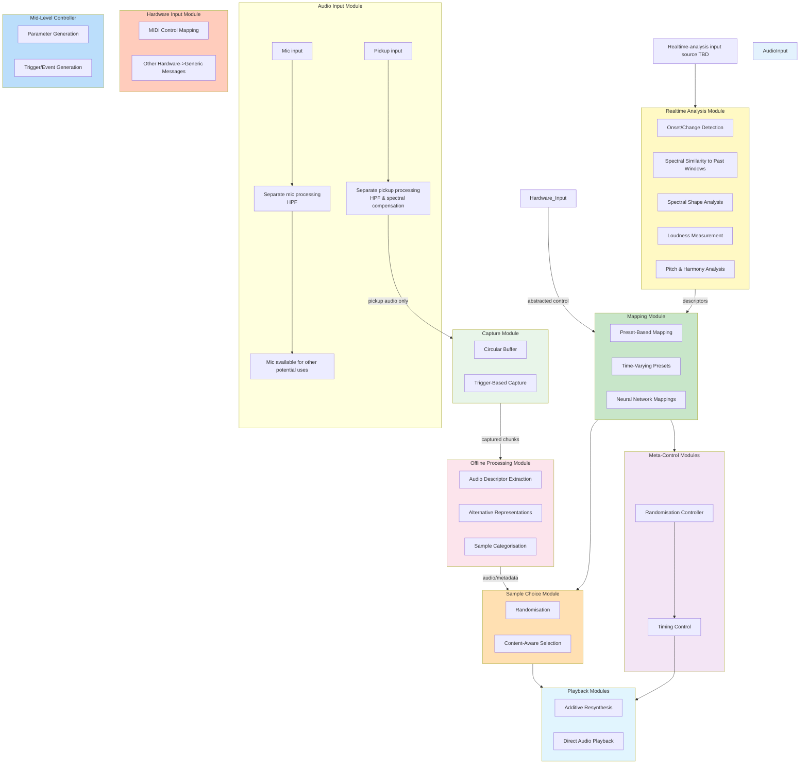
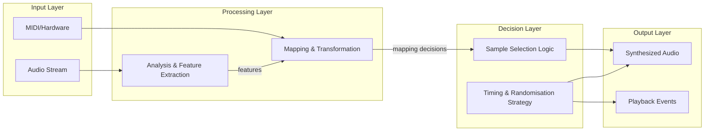
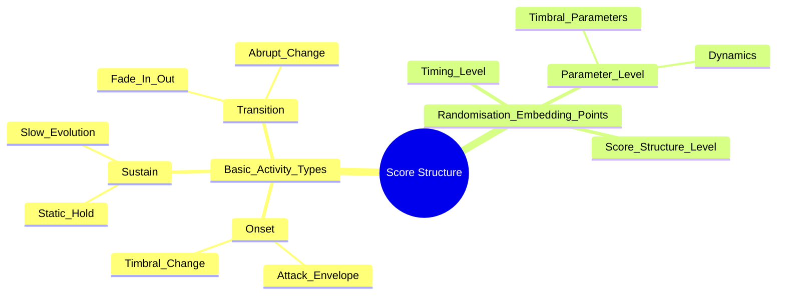
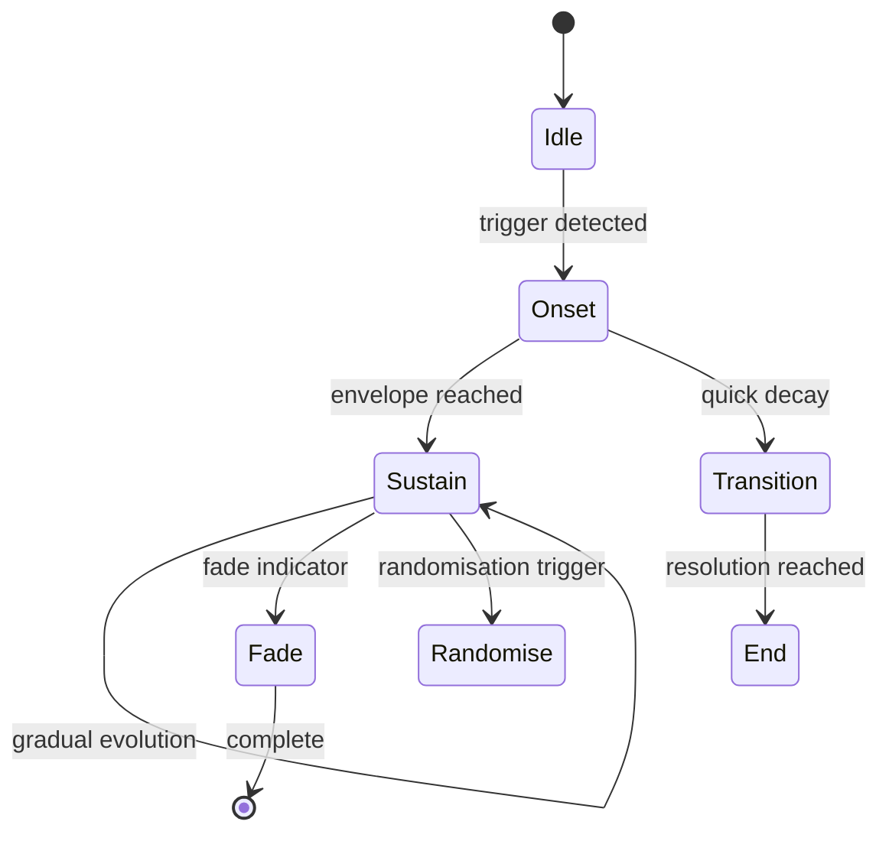
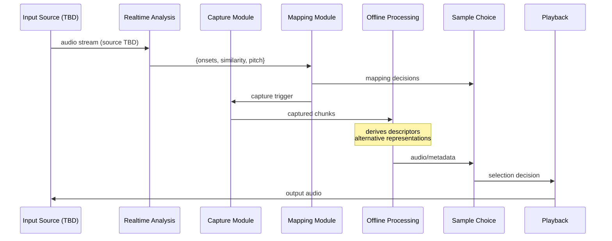

# **Marco Fusi Piece - System Architecture Visualization**

## **Main Architecture Diagram**

## **Dataflow Representation**

## **Score Activity Model**

## **State Machine for Activity Modeling**

## **Module Interaction Details**

## **Current Implementation Status**

The statuses below are additions to the proposed architecture above, not changes to it. They are based on the current Max patches and [patch progress notes](./wintersleep-patch/docs/Patch%20Progress%20%2B%20Notes.md); they reflect patch inspection, not runtime testing. **Not found** means no implementation was identified in those sources. Items marked for review are follow-up questions and do not by themselves indicate missing implementation; outstanding implementation work is identified separately as TODO.

| Area | Status | Evidence | Review | TODO |
|---|---|---|---|---|
| **Audio input** | **Implemented** | Mic and pickup are processed separately; both have an 80 Hz/order 8 high-pass filter. Pickup compensation and circular input buffering are present in [Module_Input.maxpat](./wintersleep-patch/Module_Input.maxpat). Only pickup feeds capture; the mic remains available for other potential uses. | Define mechanisms for setting parameters for the piece; decide the realtime-analysis input source. | — |
| **Compensation** | **Implemented** | Offline rolloff, body-IR, and transposition patches exist: [Compensate_Rolloff.maxpat](./wintersleep-patch/Compensate_Rolloff.maxpat), [Compensate_BodyIR.maxpat](./wintersleep-patch/Compensate_BodyIR.maxpat), and [Compensate_Transpose.maxpat](./wintersleep-patch/Compensate_Transpose.maxpat). Realtime compensation is implemented in [Compensate_Realtime.maxpat](./wintersleep-patch/Compensate_Realtime.maxpat), with [- Pickup_Correction.maxpat](./wintersleep-patch/-%20Pickup_Correction.maxpat) as its preparation patch and including a regularisation control. Bounds handling is in the call patch and mapped to 44.1 kHz. | Review smoothing behavior/defaults and whether to expose settings; whether bounds handling belongs in the IR patch; bounds handling in additive processing; whether rolloff should clip below MIDI note 46. | — |
| **Capture** | **Implemented** | Circular buffering and buffer copying/collection exist in [Capture_Circular_Buffer.maxpat](./wintersleep-patch/Capture_Circular_Buffer.maxpat) and [Capture_Buffers.maxpat](./wintersleep-patch/Capture_Buffers.maxpat). The buffer defaults to three minutes with no direct duration control. NRT buffer analysis is available separately. | Wire the capture-to-analysis workflow. | — |
| **Hardware input** | **Implemented** | Launch Control faders, encoders, and buttons exist in [Controller_LaunchControl.maxpat](./wintersleep-patch/Controller_LaunchControl.maxpat). Labels and static colors can be assigned in the editor. | Review all-MIDI-input versus targeted-port behavior, additional controls/display/LEDs, message normalization, and labeling. | — |
| **Descriptor-frame analysis** | **Implemented** | [Analysis_Descriptor_Frame.maxpat](./wintersleep-patch/Analysis_Descriptor_Frame.maxpat) provides descriptor analysis; [Analysis_NRT_ToFrames.maxpat](./wintersleep-patch/Analysis_NRT_ToFrames.maxpat) extracts frames from buffered audio. [Analysis_NRT_Stats.maxpat](./wintersleep-patch/Analysis_NRT_Stats.maxpat) computes per-descriptor statistics; [Utility_Gate_Other.maxpat](./wintersleep-patch/Utility_Gate_Other.maxpat) provides descriptor gating. NRT secondary-analysis decisions are made. | — | — |
| **Offline sample processing** | **Implemented** | [Analysis_NRT_Buffer_Analysis.maxpat](./wintersleep-patch/Analysis_NRT_Buffer_Analysis.maxpat) analyses buffered audio using [Analysis_NRT_ToFrames.maxpat](./wintersleep-patch/Analysis_NRT_ToFrames.maxpat), [Analysis_Descriptor_Frame.maxpat](./wintersleep-patch/Analysis_Descriptor_Frame.maxpat), per-descriptor [Analysis_NRT_Stats.maxpat](./wintersleep-patch/Analysis_NRT_Stats.maxpat), and [Utility_Gate_Other.maxpat](./wintersleep-patch/Utility_Gate_Other.maxpat) for gating. The patch notes describe an Offline Analysis module for threading and storage, with a single patch running descriptor and partial-tracking analysis; nested patches are not specified. A broader alternative-representation or categorisation pipeline is not identified. | Review storage. | — |
| **Spectral partial tracking** | **Implemented** | [Analysis_Peaks.maxpat](./wintersleep-patch/Analysis_Peaks.maxpat) derives spectral peaks; [Analysis_Track_Segment.maxpat](./wintersleep-patch/Analysis_Track_Segment.maxpat) turns peaks into tracks for a segment using frame-driving code. | — | — |
| **Realtime analysis** | **Partial** | [Analysis_Descriptors_RT.maxpat](./wintersleep-patch/Analysis_Descriptors_RT.maxpat) wraps descriptor-frame analysis for realtime audio. Mapping integration is not identified; see Mapping. | — | Decide on secondary realtime analysis; this affects realtime analysis, not frame-based analysis. |
| **Playback** | **Partial** | [DSP_Granular.maxpat](./wintersleep-patch/DSP_Granular.maxpat) provides a basic framelib granular voice. [DSP_Oscillator.maxpat](./wintersleep-patch/DSP_Oscillator.maxpat) and related DSP components provide oscillator, FM, Chebyshev harmonic shaping, and noise/resonance for additive playback. The additive voice patch and wider voice management are not yet in place. | Review granular panning (stereo with voice-level quad panning versus inherently quad per voice), how much of the additive voice should be dynamically controllable, and integration with control modules. | Finish the additive system; build voice management. |
| **Randomisation** | **Partial** | Randomisation utility patches are present. | Review the reported duplicate-group behavior in Random_Groups, currently used in drift shadow; the notes suggest it may relate to how the Urn implementation operates across chosen items. | Build further modules and combinations. |
| **Score activity model** | **Open** | No implemented model is identified. | Model the basic score activity types; decide where timing/randomisation should be contextual. | — |
| **Sample choice** | **Not found** | Content-aware or sample-based selection is not identified. | — | — |
| **Timing control** | **Not found** | No implementation is identified in the available patches. | — | — |
| **Mapping** | **Not found** | No implementation is identified in the available patches. | — | — |
| **Mid-level control** | **Not found** | No implementation is identified in the available patches. | — | — |
